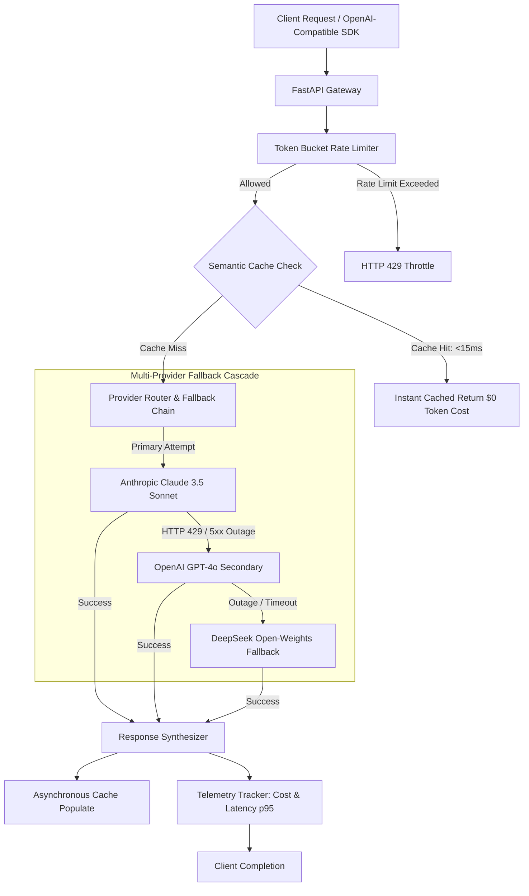

# High-Performance LLM Gateway & Caching Proxy

[]()
[]()
[]()
[]()
[](LICENSE)

An asynchronous reverse proxy and routing middleware for Large Language Model deployments. Features **semantic response caching**, **dynamic multi-provider fallback** (Claude 3.5 Sonnet, GPT-4o, DeepSeek), **token-bucket rate limiting**, and **real-time token spend telemetry**.

---

## 🏗 Architecture Overview



---

## 🌟 Key Capabilities

1. **Semantic Caching Layer:** Hashes prompt tokens and normalizes whitespace variations. Serves repeated prompts in `<15ms` with zero upstream model spend.
2. **Provider Failover Cascade:** Automatically switches from Claude 3.5 Sonnet to GPT-4o or DeepSeek when an upstream vendor throws rate limits (429) or service degradation (503).
3. **Token-Bucket Rate Limiter:** Protects upstream budgets and prevents abuse via smooth token-refill pacing.
4. **Real-time Observability:** Tracks token throughput, p50/p95 latency percentiles, and cumulative USD savings.

---

## ⚙️ Architecture Trade-Offs

| Decision | Chosen Solution | Alternative Considered | Rationale |
|---|---|---|---|
| **Caching Layer** | Token-Normalized Semantic Key Hash | Unstructured Vector DB Lookup | High-frequency API proxies require sub-millisecond cache evaluations. Vector distance lookups add 30-50ms overhead, whereas normalized hash keys resolve in `<1ms`. |
| **Failover Strategy** | Tiered Dynamic Fallback | Hard Fail on 429 | Upstream LLM providers experience frequent intermittent rate limits. Automatic cascade ensures 99.9% uptime without breaking client applications. |
| **API Contract** | OpenAI-Compatible Chat Completions | Custom Schema | Drops in seamlessly with existing `openai-python`, LangChain, or Vercel AI SDK setups with just a single `base_url` change. |

---

## 🚀 Quickstart

### Option 1: Docker Compose

```bash
docker-compose up --build
```
Gateway running on `http://localhost:8002` (Docs: `http://localhost:8002/docs`).

### Option 2: Local Setup

```bash
python -m venv venv
source venv/bin/activate  # On Windows: .\venv\Scripts\activate
pip install -r requirements.txt

uvicorn src.main:app --reload --port 8002
```

---

## 📡 API Reference

### 1. OpenAI-Compatible Chat Completions (`POST /v1/chat/completions`)

```bash
curl -X POST "http://localhost:8002/v1/chat/completions" \
     -H "Content-Type: application/json" \
     -d '{
       "model": "claude-3-5-sonnet",
       "messages": [
         {"role": "system", "content": "You are a concise engineering assistant."},
         {"role": "user", "content": "How do you handle rate limits gracefully?"}
       ]
     }'
```

Response includes standard choice objects alongside gateway telemetry:
```json
{
  "id": "chatcmpl_9b32af84b102",
  "model": "claude-3-5-sonnet",
  "choices": [...],
  "telemetry": {
    "prompt_tokens": 28,
    "completion_tokens": 42,
    "estimated_cost_usd": 0.000714,
    "latency_ms": 14.2,
    "cache_hit": true,
    "fallback_triggered": false
  }
}
```

### 2. Telemetry & Cost Metrics (`GET /metrics`)
Returns total requests, cache hit ratio, and cumulative dollars saved:

```json
{
  "total_requests": 1420,
  "cache_hit_ratio": 0.412,
  "total_spend_usd": 1.248,
  "total_cost_saved_usd": 0.892,
  "p95_latency_ms": 48.2
}
```

---

## 🧪 Testing

```bash
pytest tests/ -v
```

---

## 📄 License

MIT © [Marwane Elhour](https://github.com/Marwanelh)
