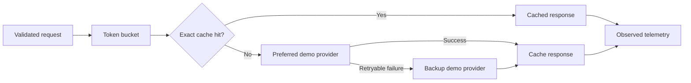

# Provider Gateway Lab

A local FastAPI reference implementation for the backend concerns around AI-provider integrations: request validation, exact response caching, concurrency-safe rate limiting, retryable failover, and observable request telemetry.

## Honest scope

This project uses deterministic local demo providers. It does not call OpenAI, Anthropic, DeepSeek, or another external service; it does not claim compatibility with their APIs; and it does not report guessed token costs or production performance.

The purpose is to make the gateway behavior runnable and reviewable without credentials while keeping the integration boundaries clear.

## Architecture



## What it demonstrates

- Bounded Pydantic request contracts
- Cache keys that include every response-affecting request field
- TTL expiration with an injectable monotonic clock
- Async-lock-protected token-bucket rate limiting
- Explicit retryable provider errors and ordered failover
- Telemetry based on observed requests, latency, cache hits, and failovers
- Clear HTTP 400, 422, 429, and 503 behavior
- Automated tests and GitHub Actions

## Run

```bash
python -m venv .venv
# Windows: .venv\Scripts\activate
# macOS/Linux: source .venv/bin/activate
pip install -r requirements.txt
uvicorn src.main:app --reload --port 8002
```

Open `http://localhost:8002/docs` for the interactive API.

```bash
python -m pytest -q
```

## Example

```bash
curl -X POST http://localhost:8002/v1/responses \
  -H "Content-Type: application/json" \
  -d '{
    "messages": [{"role": "user", "content": "Explain safe retries"}],
    "temperature": 0.2,
    "max_output_chars": 500
  }'
```

Endpoints:

| Method | Endpoint | Purpose |
|---|---|---|
| `POST` | `/v1/responses` | Validate, limit, cache, and route a request |
| `GET` | `/metrics` | Read observed in-process metrics |
| `GET` | `/health` | Health check |

## Production upgrade path

- Implement authenticated provider adapters behind the same router contract.
- Replace the in-memory cache and telemetry store with shared infrastructure.
- Add per-tenant limits, authentication, request IDs from trusted boundaries, and audit retention.
- Use vendor-reported usage and a versioned pricing source if cost reporting is needed.
- Define retry budgets, jittered backoff, circuit breakers, and idempotency behavior from provider contracts.

## Scope

Independent portfolio project using synthetic requests only. It contains no FillFlow code, client data, credentials, or production metrics.

## Author

[Marwane Elhour](https://github.com/Marwanelh) · [LinkedIn](https://www.linkedin.com/in/marwanelh/)
